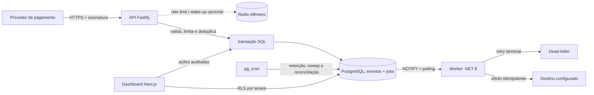

<p align="center">
  
</p>

<p align="center">
  <strong>Ingestão segura. <span style="color:#FF6B00">Fluxo confiável.</span></strong>
</p>

<p align="center">
  Plataforma self-hosted para receber webhooks financeiros, processar efeitos
  assíncronos e operar integrações multi-tenant com rastreabilidade.
</p>

<p align="center">
  <a href="LICENSE"></a>
  <a href="SECURITY.md"></a>
</p>

## Cenário real do projeto

O Sluice é o plano operacional de uma aplicação que recebe notificações de
pagamento e eventos de provedores externos para múltiplos clientes (tenants).
Ele não é um ERP nem uma página de demonstração: recebe o webhook assinado,
preserva o evento com segurança, cria o trabalho durável e executa o efeito de
destino de forma controlada. O dashboard serve para acompanhar essa operação e
administrar fontes, destinos e pipelines dentro do tenant autorizado.

Os adaptadores implementados hoje atendem **Asaas, PagBank, Mercado Pago,
Stripe e PIX configurável**. Cada fonte ganha uma URL própria:

```text
POST /v1/webhooks/:provider/:endpointKey
```

O painel conectado lê o PostgreSQL de verdade: eventos, jobs, dead-letter,
fontes, destinos, pipelines, auditoria, notificações e saúde dos serviços.
`SLUICE_DEMO_MODE=true` existe somente para demonstração isolada; não é o modo
de operação normal.

## Fluxo operacional



1. A API valida a assinatura específica do provedor e o schema mínimo do
   evento antes de persistir qualquer coisa.
2. Evento e primeiro job são registrados na mesma transação SQL. A chave
   `(tenant, fonte, ID externo)` impede duplicidade durável.
3. O worker faz claim com lease e fencing token, processa o destino e confirma
   ou agenda o retry. Falha terminal fica em dead-letter; redrive cria outro
   job e mantém o histórico.
4. O dashboard mostra esse estado por tenant e grava mudanças administrativas
   com auditoria. A tela de Workers mostra atividade de jobs e healthchecks; ela
   não inventa métricas de CPU/memória que o runtime não publica.

## Garantias e limites

- A fila é **at-least-once**. Lease e fencing evitam que um worker antigo
  confirme um job recuperado por outro.
- Destinos recebem chave idempotente para comportamento effectively-once quando
  também suportam idempotência.
- Payloads brutos usam envelope encryption e expiram pela política de retenção;
  hashes mínimos de deduplicação permanecem.
- PostgreSQL é a fonte de verdade. Redis é usado apenas para rate limit e
  wake-up opcional — nunca para armazenar jobs.
- RLS com `FORCE ROW LEVEL SECURITY` separa os tenants no banco.

Não há promessa de “exactly once” para chamadas HTTP. Veja a
[semântica de entrega](docs/architecture.md#semântica-de-entrega).

## Componentes

| Componente | Tecnologia | Responsabilidade |
|---|---|---|
| `apps/ingest-api` | Node.js, TypeScript, Fastify | Autenticação, rate limit, validação e persistência de webhooks |
| `apps/worker` | C#/.NET 8 Worker Service, Npgsql | Claim, heartbeat, handlers, retry, redrive e dead-letter |
| `apps/dashboard` | Next.js, React | Operação por tenant e administração auditada |
| `database` | PostgreSQL 17, pg_cron | Estado durável, fila, RLS, retenção e agendamento |
| Redis | Redis 7 | Rate limit e canal opcional de wake-up |

## Banco: SQL, não Prisma

Este projeto **não usa Prisma**. O esquema, funções, políticas RLS e contratos
vivem em [`database/migrations`](database/migrations) como migrações SQL
idempotentes. No primeiro volume do PostgreSQL, o bootstrap
`infra/postgres/init/00-bootstrap.sh` cria roles e aplica as migrações em ordem.

Para reaplicar as migrações em uma stack local já existente:

```powershell
docker compose --env-file .env `
  -f docker-compose.yml `
  -f infra/compose.apps.yml `
  -f infra/compose.dev.yml `
  exec -T postgres /docker-entrypoint-initdb.d/00-bootstrap.sh
```

O procedimento, as roles de aplicação e os testes de contrato estão em
[Banco, roles e contratos SQL](docs/database.md).

## Rodar localmente

Pré-requisitos: Docker Engine 24+ com Compose 2.24+, Node.js 22+ e, para validar
o worker fora do container, .NET SDK/runtime 8.

No PowerShell:

```powershell
Copy-Item .env.example .env
# Troque os valores de desenvolvimento antes de expor qualquer porta.

docker compose --env-file .env `
  -f docker-compose.yml `
  -f infra/compose.apps.yml `
  -f infra/compose.dev.yml `
  up --build -d

docker compose --env-file .env `
  -f docker-compose.yml `
  -f infra/compose.apps.yml `
  -f infra/compose.dev.yml ps
```

Portas locais do overlay de desenvolvimento:

| Serviço | URL |
|---|---|
| Dashboard | <http://localhost:3000> |
| API de ingestão | <http://localhost:3001> |
| Diagnósticos do worker | <http://localhost:8082> |

Crie o primeiro owner e uma fonte de teste pelo
[modo conectado](docs/local-development.md#modo-conectado). O Compose base só
inicia o plano de dados; `infra/compose.apps.yml` adiciona as aplicações e
`infra/compose.dev.yml` publica portas para a máquina local.

## Testes

Os testes rápidos por aplicação:

```powershell
npm --prefix apps/ingest-api run typecheck
npm --prefix apps/ingest-api run lint
npm --prefix apps/ingest-api test

npm --prefix apps/dashboard run typecheck
npm --prefix apps/dashboard run lint
npm --prefix apps/dashboard test
```

Com a stack ativa, valide os contratos SQL:

```powershell
Get-Content database/tests/contracts.sql | docker compose --env-file .env `
  -f docker-compose.yml `
  -f infra/compose.apps.yml `
  -f infra/compose.dev.yml `
  exec -T postgres sh -ec 'PGPASSWORD="$POSTGRES_PASSWORD" exec psql --no-psqlrc -v ON_ERROR_STOP=1 -U "$POSTGRES_USER" -d "$POSTGRES_DB"'
```

O teste conectado cria recursos efêmeros, exercita autorização, CRUD auditado e
webhooks assinados de todos os cinco provedores; ao final desativa as fontes
criadas:

```powershell
$env:SLUICE_CONNECTED_E2E = "1"
npm --prefix apps/dashboard run test:connected
```

Em ambientes Unix que tenham `make`, `make test` reúne validação do Compose,
contratos SQL, API, dashboard e worker. Consulte
[Desenvolvimento local](docs/local-development.md) para as opções completas.

## Documentação

- [Arquitetura e decisões](docs/architecture.md)
- [Desenho do sistema e fluxos](docs/system-design.md)
- [Banco, roles e contratos SQL](docs/database.md)
- [Autenticação por provedor](docs/provider-authentication.md)
- [API HTTP e contratos de entrega](docs/api.md)
- [Operação, observabilidade, backup e recuperação](docs/operations.md)
- [Segurança e threat model](docs/security.md)
- [Retenção e LGPD](docs/lgpd-retention.md)
- [Checklist de liberação](docs/production-readiness.md)
- [Worker C#/.NET 8](apps/worker/README.md)
- [Changelog](CHANGELOG.md) e [roadmap](ROADMAP.md)

## Produção e responsabilidade

O Compose incluso é uma referência operacional, não um desenho completo de alta
disponibilidade. Em produção, termine TLS na borda, mantenha aplicações e banco
em redes separadas, injete segredos por um secret manager, habilite backup/PITR,
restrinja o egress do worker e faça testes de restauração e carga.

Sluice está em pré-release e é fornecido nos termos da Apache License 2.0. Antes
de tratar dados reais, faça revisão independente de segurança, privacidade,
retenção e conformidade aplicável.

## Contribuir

Leia [CONTRIBUTING.md](CONTRIBUTING.md), o [Código de Conduta](CODE_OF_CONDUCT.md)
e a [política de segurança](SECURITY.md). Contribuições são aceitas sob
[Apache License 2.0](LICENSE).
