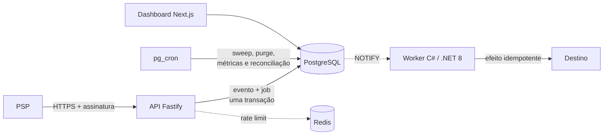

<p align="center">
  
</p>

<p align="center">
  <strong>Ingestão segura. <span style="color:#FF6B00">Fluxo confiável.</span></strong>
</p>

<p align="center">
  Plataforma open source e self-hosted para receber webhooks, processar jobs e
  operar integrações multi-tenant com segurança.
</p>

<p align="center">
  <a href="LICENSE"></a>
  <a href="SECURITY.md"></a>
</p>

## O que é o Sluice

Sluice é uma plataforma de ingestão de webhooks e execução assíncrona voltada
ao ecossistema fintech e às PMEs brasileiras. O projeto mantém o estado durável
em PostgreSQL, usa Redis apenas para funções efêmeras e pode ser operado
inteiramente na infraestrutura da organização.

O fluxo principal é:



### Garantias explícitas

- Cada `(tenant, fonte, ID externo)` possui uma chave de deduplicação durável.
- Evento e primeiro job são gravados na mesma transação.
- A fila é **at-least-once**. Lease e fencing token impedem que um worker antigo
  conclua um job recuperado por outro.
- Efeitos externos usam uma chave idempotente para oferecer comportamento
  effectively-once quando o destino também suporta idempotência.
- Jobs terminais não são reabertos. Um redrive cria outro job e preserva o
  histórico.
- Payload bruto usa envelope encryption e é apagado automaticamente; os hashes
  mínimos de deduplicação permanecem.
- RLS está habilitado com `FORCE ROW LEVEL SECURITY` em todas as tabelas
  multi-tenant.

Não há promessa tecnicamente impossível de “exactly once” em chamadas HTTP.
Consulte [Semântica da fila](docs/architecture.md#semântica-de-entrega).

## Componentes

| Componente | Tecnologia | Responsabilidade |
|---|---|---|
| `apps/ingest-api` | Node.js, TypeScript, Fastify | Autenticar, limitar, validar e persistir webhooks |
| `apps/worker` | C#/.NET 8 Worker Service, Npgsql | Claim, heartbeat, handlers, retry e dead-letter |
| `apps/dashboard` | Next.js 16.2.12, React 19.2.8 | Operação por tenant, métricas e administração |
| `database` | PostgreSQL 17, pg_cron | Estado durável, fila, RLS, retenção e agendamento |
| Redis | Redis 7 | Rate limit e canal opcional de wake-up; nunca jobs |

O dashboard usa Next.js 16.2.12 e React 19.2.8 no lugar da referência inicial
Next.js 14 para hardening de dependências, preservando a identidade visual e os
contratos de dados.

## Início rápido

Pré-requisitos: Docker Engine 24+ com Compose 2.24+ e Git.

```bash
cp .env.example .env
# Troque senhas, segredo de sessão e as chaves mestras de desenvolvimento.
docker compose --env-file .env \
  -f docker-compose.yml \
  -f infra/compose.apps.yml \
  -f infra/compose.dev.yml \
  up --build -d
```

Esse comando inicia PostgreSQL, Redis, API, worker C#/.NET 8 e dashboard. O
passo a passo para depurar cada aplicação fora dos containers está em
[Desenvolvimento local](docs/local-development.md).

O arquivo base contém o plano de dados. `infra/compose.apps.yml` adiciona as
aplicações e suas redes; `infra/compose.dev.yml` publica portas somente para
desenvolvimento local.

Verifique o banco:

```bash
docker compose --env-file .env -f docker-compose.yml exec -T postgres sh -ec \
  'PGPASSWORD="$POSTGRES_PASSWORD" psql --no-psqlrc \
  -U "$POSTGRES_USER" -d "$POSTGRES_DB" \
  -c "select extname from pg_extension order by 1"'
```

Os comandos equivalentes estão no [Makefile](Makefile):

```bash
make doctor
make up
make test-db
```

`make test` valida Compose, contratos do banco, API, dashboard e worker
C#/.NET 8. A stack precisa estar ativa para os contratos SQL.

Portas sugeridas para o conjunto completo:

| Serviço | URL local |
|---|---|
| Dashboard | `http://localhost:3000` |
| API de ingestão | `http://localhost:3001` |
| Diagnósticos do worker | `http://localhost:8082` |

O dashboard inicia conectado ao PostgreSQL. Crie o primeiro owner pelo
procedimento de [bootstrap local](docs/local-development.md#modo-conectado).

## Produção

O Compose incluído é uma referência operacional, não substitui desenho de
capacidade, alta disponibilidade nem gestão de segredos. Em produção:

- combine o arquivo base com `infra/compose.apps.yml` e, quando aplicável, o
  overlay TLS; não use `infra/compose.dev.yml`;
- termine HTTPS na borda e mantenha API, worker e dashboard em serviços
  separados;
- habilite TLS também entre aplicações, PostgreSQL e Redis;
- injete a KEK mestra por um secret manager fora do banco e dos backups;
- use WAL archiving/PITR, cópia externa criptografada e testes periódicos de
  restauração;
- restrinja egress do worker por allowlist para reduzir SSRF;
- execute teste de carga e defina SLOs antes de receber tráfego real.

Veja o [runbook de operação](docs/operations.md) e o
[modelo de segurança](docs/security.md).

## Documentação

- [Arquitetura e decisões](docs/architecture.md)
- [Desenho de sistema e fluxos](docs/system-design.md)
- [Banco, roles e contratos SQL](docs/database.md)
- [Segurança e threat model](docs/security.md)
- [Retenção e LGPD](docs/lgpd-retention.md)
- [Autenticação por provedor](docs/provider-authentication.md)
- [API HTTP e contratos de entrega](docs/api.md)
- [Operação, TLS, backup e recuperação](docs/operations.md)
- [Checklist de liberação para produção](docs/production-readiness.md)
- [Desenvolvimento local](docs/local-development.md)
- [Worker C#/.NET 8](apps/worker/README.md)
- [Changelog](CHANGELOG.md)
- [Roadmap](ROADMAP.md)

## Status e responsabilidade

Sluice é disponibilizado sem garantias, nos termos da Apache License 2.0.
O projeto está em estágio pré-release e seus contratos ainda podem evoluir.
Antes de uso produtivo, faça revisão independente de segurança, privacidade e
conformidade aplicável ao seu tratamento de dados. A configuração sugerida de
90 dias é apenas um padrão técnico; não constitui uma base legal ou prazo
universal da LGPD.

## Contribuir

Leia [CONTRIBUTING.md](CONTRIBUTING.md), o
[Código de Conduta](CODE_OF_CONDUCT.md) e a
[política de segurança](SECURITY.md). Contribuições são aceitas sob
[Apache License 2.0](LICENSE).
