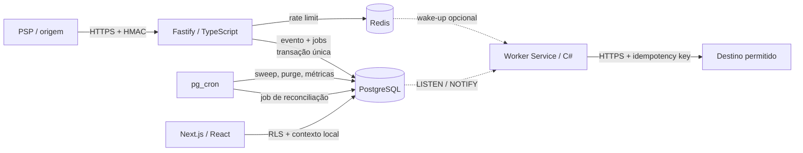

# Arquitetura do Sluice

## Objetivo

O Sluice recebe webhooks de provedores de pagamento, registra cada evento antes
de processá-lo e executa integrações assíncronas com isolamento por tenant. A
plataforma é self-hosted, licenciada sob Apache 2.0 e evita dependências de
mensageria gerenciada.

Os princípios que orientam a implementação são:

- PostgreSQL é a fonte de verdade para eventos, jobs, tentativas e auditoria;
- Redis contém somente estado efêmero de rate limit; seu canal de wake-up é
  opcional e não substitui `LISTEN/NOTIFY` nem polling;
- o caminho de ingestão responde rapidamente e nunca executa o efeito externo;
- o worker e todo o processamento de jobs são implementados em C#/.NET 8;
- dados pessoais e payloads brutos têm criptografia e expiração explícitas;
- nenhuma decisão de aplicação substitui o isolamento RLS do banco.

## Visão de componentes



O deploy possui três imagens de aplicação independentes:

| Serviço | Runtime | Responsabilidade |
|---|---|---|
| `ingest-api` | Node.js 22, Fastify, TypeScript | autenticação do PSP, schema, rate limit e persistência |
| `worker` | .NET 8 Worker Service, Npgsql | claim, heartbeat, entrega, reconciliação, retry e dead-letter |
| `dashboard` | Next.js 16.2, React 19 | operação, configuração, métricas e redrive administrativo |

PostgreSQL e Redis são dependências de infraestrutura, não filas alternativas.

## Fluxo de ingestão

1. A rota contém o provedor e uma `endpoint_key` opaca. O `tenant_id` nunca é
   aceito do corpo.
2. A API exige HTTPS em produção e preserva o corpo original como `Buffer`.
3. A fonte é resolvida no PostgreSQL; seu segredo e configuração são abertos
   somente em memória com AES-256-GCM.
4. O adaptador do provedor extrai a assinatura, valida HMAC em tempo constante,
   aplica a janela temporal quando o protocolo a oferece e valida o schema.
5. Redis aplica o limite por fonte. A política padrão é fail-closed.
6. O ID externo e o payload recebem hashes; o payload bruto é cifrado com uma
   chave de dados aleatória.
7. `ingest_event_and_enqueue` grava evento e jobs na mesma transação. A
   restrição única `(tenant_id, source_id, external_event_id_hash)` resolve
   concorrência e repetição.
8. A API retorna `200` tanto para o primeiro recebimento aceito quanto para uma
   repetição idempotente já registrada.

Um evento só se torna visível ao worker depois que a transação foi confirmada.

## Semântica de entrega

O Sluice oferece fila **at-least-once**. Não declara “exactly once” para HTTP,
pois não existe transação atômica entre PostgreSQL e um servidor externo.

O comportamento effectively-once é obtido pela combinação:

- chave única de ingestão por tenant/fonte/evento externo;
- chave única de job por tenant/tipo/idempotência;
- `Idempotency-Key` estável enviado ao destino;
- registro durável do efeito em `job_delivery_effects`;
- redrive que cria um novo job e nunca reabre o registro terminal.

Destinos devem honrar a chave de idempotência. Sem essa cooperação, uma queda
após o destino aplicar o efeito e antes do commit local pode causar nova chamada.

## Claim, lease e fencing no worker C#

O worker abre concorrência limitada e chama `sluice.claim_jobs`. A função usa
`FOR UPDATE SKIP LOCKED`, ordena por prioridade e criação e muda os jobs
selecionados para `processing` na mesma transação.

Cada claim recebe um `lease_token` novo. Heartbeat, conclusão, retry e
dead-letter exigem simultaneamente:

- mesmo `tenant_id`;
- mesmo `job_id`;
- status `processing`;
- mesmo `claimed_by`;
- mesmo `lease_token`;
- lease ainda pertencente ao chamador.

Esse token funciona como fencing: depois que o sweep recupera um lease expirado,
um processo antigo não consegue confirmar resultado atrasado.

O backoff é exponencial com jitter e limite. Ao atingir `max_attempts`, o job vai
para `dead_letter`, uma notificação durável é criada e um wake-up é publicado.
Jobs terminais não são apagados pela fila.

## Handlers em C#

`webhook.process`/entrega HTTP:

- carrega evento, destino e configuração pelo contrato SQL;
- recusa payload já purgado;
- abre o envelope em memória;
- valida URL e allowlist antes de cada conexão;
- bloqueia loopback, redes privadas, link-local, multicast e DNS rebinding;
- envia HTTPS com timeout, sem seguir redirect automaticamente;
- classifica falhas transitórias e permanentes;
- registra a tentativa e o efeito idempotente.

Reconciliação:

- recebe um job criado pelo `pg_cron`;
- usa endpoint fixo configurado por provedor, nunca uma URL arbitrária do job;
- limita a busca à janela da fonte, entre 1 e 168 horas;
- atualiza checkpoint durável e produz eventos/jobs pelo mesmo caminho de
  idempotência.

Notificações de dead-letter são consumidas a partir de
`notification_outbox`. Falha de entrega mantém o registro para retry.
`LISTEN/NOTIFY` reduz a latência, com polling como fallback. O subscriber Redis
aceita sinais de um publisher externo opcional; o deploy padrão não depende
dele.

## Agendamento

`pg_cron` é o único scheduler padrão. Ele executa:

- recuperação de leases expirados;
- purge de payloads vencidos;
- rollup horário de métricas;
- enqueue de reconciliações dentro da janela permitida.

Isso elimina leader election entre réplicas. Um scheduler interno com advisory
lock não é incluído na configuração padrão e só deve existir em um fork cuja
plataforma realmente não ofereça `pg_cron`.

## Multi-tenancy

Todas as tabelas de domínio carregam `tenant_id`, inclusive tabelas filhas. As
foreign keys compostas impedem que um relacionamento aponte para recurso de
outro tenant.

As roles de runtime não são proprietárias das tabelas e não possuem
`BYPASSRLS`. A role do dashboard usa uma transação por operação:

```sql
BEGIN;
SELECT set_config('app.tenant_id', $1, true);
SELECT set_config('app.user_id', $2, true);
-- consulta ou mutação autorizada
COMMIT;
```

O terceiro argumento `true` torna o contexto local à transação, evitando vazá-lo
quando a conexão volta ao pool.

API e worker não recebem acesso amplo às tabelas. Suas operações críticas são
funções `SECURITY DEFINER` com `search_path` fixo, permissões mínimas e validação
interna do tenant.

## Criptografia de envelope

O banco armazena um JSON binário versionado, nunca a chave mestra:

```text
Envelope v1
├── algoritmo: A256GCM
├── kid: versão da KEK
├── wrappedKey: DEK aleatória cifrada pela KEK
└── data: conteúdo cifrado pela DEK
```

AAD incorpora versão da chave e contexto do recurso. Um envelope movido para
outro tenant, fonte, evento ou destino deixa de autenticar. API, dashboard e
worker compartilham o formato, mas recebem a KEK por segredo de runtime.

Rotação adiciona uma nova versão ao keyring, muda a versão ativa para novas
escritas e mantém versões antigas somente durante a recifragem controlada.

## Falhas e recuperação

| Falha | Comportamento |
|---|---|
| Redis indisponível | ingestão retorna 503 por padrão; jobs existentes continuam no PostgreSQL |
| worker cai durante chamada | lease expira; sweep recupera; idempotency key protege o destino |
| PostgreSQL indisponível | API não confirma o evento e retorna erro para o PSP tentar novamente |
| NOTIFY perdido | polling periódico encontra o job |
| destino 429/5xx/timeout | retry com backoff |
| destino 4xx permanente | dead-letter conforme classificação |
| payload expirado | bytes pessoais são apagados; hashes e auditoria mínima permanecem |
| instância atrasada conclui lease antigo | fencing token rejeita a transição |

## Escala

- aumente réplicas do worker antes de aumentar a concorrência de uma única
  instância;
- dimensione o pool para não exceder `max_connections`;
- mantenha batches curtos para reduzir tempo sob locks;
- particionamento é uma evolução para tabelas muito grandes, não requisito de
  correção;
- `LISTEN/NOTIFY` e Redis não devem carregar payload nem ser fonte de verdade;
- acompanhe profundidade, idade do job mais antigo, duração, retry e dead-letter.

## Decisões fechadas

1. PostgreSQL com `SKIP LOCKED`, não RabbitMQ.
2. Redis somente para rate limit e wake-up externo opcional, nunca estado
   durável.
3. `pg_cron`, não cron distribuído.
4. C#/.NET para worker e processamento; Node.js na borda e no dashboard.
5. PostgreSQL self-hosted/local, sem Supabase.
6. identidade do produto em grafite, branco e laranja `#FF6B00`.

A especificação inicial citava Next.js 14. O dashboard usa a linha estável
16.2, com dependências auditadas no lockfile. Essa exceção de hardening não
altera fronteiras de serviço nem modelo de dados.
