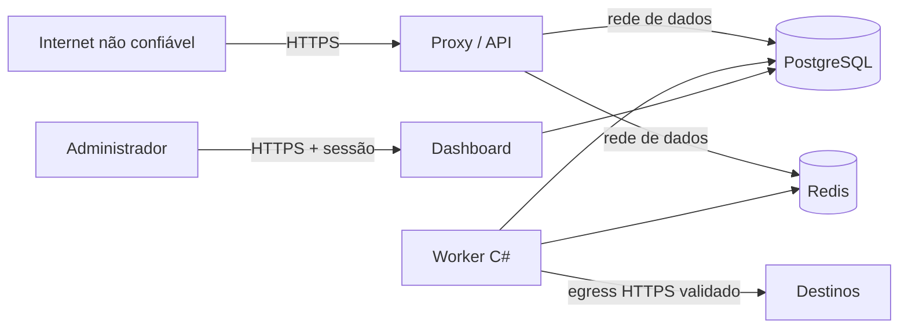

# Modelo de segurança

Este documento descreve controles técnicos do repositório. Ele não substitui
threat modeling do ambiente, pentest, DPO, assessoria jurídica nem gestão
operacional de incidentes.

## Ativos protegidos

- segredos HMAC dos provedores;
- payloads brutos e IDs externos;
- chaves mestras de envelope encryption;
- credenciais das roles PostgreSQL e do Redis;
- configuração de destinos e tokens de saída;
- sessões administrativas;
- integridade da fila, do histórico e da auditoria.

## Fronteiras de confiança

PostgreSQL e Redis não devem ser publicados na internet. O proxy precisa
normalizar cabeçalhos e substituir, não concatenar cegamente,
`X-Forwarded-Proto`.

## Controles implementados

### Entrada

- HTTPS obrigatório no endpoint de webhook em produção;
- body limit global e limite específico da fonte;
- rota opaca; o tenant não vem do JSON;
- assinatura validada sobre bytes originais;
- comparação HMAC em tempo constante;
- janela temporal/replay quando suportada pelo provedor;
- schema específico antes da persistência;
- rate limit Redis antes da primeira escrita;
- logs removem a chave opaca do caminho.

### Dados

- AES-256-GCM com DEK aleatória por envelope;
- AAD vincula envelope ao contexto;
- KEK/keyring somente por variável/secret mount de runtime;
- TLS 1.3 obrigatório no banco e CA validada pelas aplicações no overlay de
  produção;
- credenciais SCRAM distintas por serviço;
- RLS forçado e foreign keys compostas por tenant;
- funções privilegiadas com `search_path` controlado;
- purge automático de payload, headers e erros potencialmente pessoais;
- auditoria append-only.

### Processamento

- claim transacional com `SKIP LOCKED`;
- lease, heartbeat e fencing token;
- idempotency key por efeito;
- retry limitado e dead-letter explícito;
- redirects de saída desabilitados;
- somente HTTPS;
- allowlist de hostname;
- resolução DNS validada e bloqueio de IP privado, loopback, link-local,
  multicast e endereços especiais;
- URL de reconciliação é configuração fixa, não dado do job.

### Administração

- senha armazenada como Argon2id;
- sessão JWT assinada, curta, `HttpOnly` e `SameSite=Lax`;
- cookie `Secure` por padrão em produção;
- checagem de origem nas mutações;
- papéis owner/admin/operator/viewer;
- autorização repetida no banco;
- redrive cria job novo e registra auditoria.

## Responsabilidades do operador

Antes de produção:

1. gere senhas únicas e uma KEK com 32 bytes de entropia;
2. use secret manager e impeça segredo em imagem, Git, log ou backup;
3. termine TLS 1.2+ na borda e habilite TLS no tráfego interno conforme o risco;
4. restrinja egress do worker no firewall além da validação da aplicação;
5. limite acesso administrativo por identidade corporativa/VPN;
6. proteja `/metrics` com token e rede privada;
7. configure backup, PITR, restauração testada e destruição de mídia;
8. centralize logs sem payload e aplique retenção;
9. execute SAST, dependency scan, image scan, DAST, pentest e teste de carga;
10. substitua as credenciais de demonstração e mantenha
    `SLUICE_DEMO_MODE=false`.

MFA possui campo de domínio, mas um fluxo completo de segundo fator não está
ativado nesta primeira versão. Ambientes regulados devem integrar OIDC/SAML ou
implementar MFA antes de expor administração à internet.

## Threat model resumido

| Ameaça | Controle principal | Risco residual |
|---|---|---|
| falsificação de webhook | HMAC + endpoint opaco + janela temporal | vazamento do segredo do PSP |
| replay | deduplicação durável + timestamp do provedor | protocolo sem timestamp ainda exige dedupe |
| spoofing de tenant | tenant derivado da fonte + RLS | comprometimento de credencial de runtime |
| exaustão da fila | rate limit fail-closed + body limit | DDoS volumétrico exige proteção de borda |
| leitura de backup | envelope encryption | KEK e backup comprometidos juntos |
| SSRF | HTTPS + allowlist + validação DNS/IP + sem redirects | erro de política de egress/allowlist |
| dupla entrega | idempotency key + efeito durável | destino que ignora idempotência |
| worker antigo confirma | fencing token | bug em handler customizado fora do contrato |
| abuso administrativo | RBAC + RLS + auditoria | conta privilegiada comprometida |

## Segredos e rotação

`SLUICE_MASTER_KEYS` usa entradas `versão:base64`, separadas por vírgula. Para
rotacionar:

1. adicione a nova versão a todas as instâncias;
2. reinicie e verifique readiness;
3. mude `SLUICE_ACTIVE_KEY_VERSION`;
4. recifre recursos em lotes auditáveis;
5. confirme que não há envelope com a versão antiga;
6. remova a chave antiga e registre a destruição.

Nunca renumere ou substitua material de uma versão existente.

Credenciais PostgreSQL devem ser rotacionadas uma role por vez. Reinicie o
serviço correspondente e encerre sessões antigas somente depois do health
check.

## Resposta a incidente

1. preserve auditoria e logs; não copie payload para tickets;
2. identifique tenants, fontes, destinos e intervalo afetados;
3. revogue segredo ou credencial comprometida;
4. bloqueie egress/ingress necessário;
5. rotacione KEK apenas com plano para envelopes existentes;
6. avalie obrigações de comunicação e ANPD com o encarregado;
7. recupere por PITR se a integridade do banco estiver em dúvida;
8. documente causa, linha do tempo e controles corretivos.

Vulnerabilidades devem seguir [SECURITY.md](../SECURITY.md), sem issue pública
antes de coordenação.
