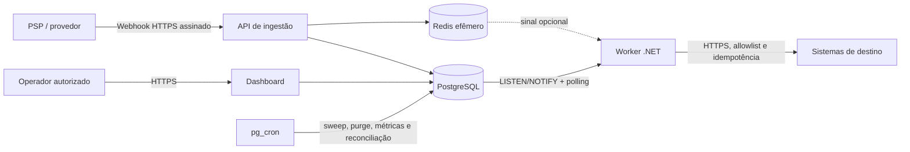
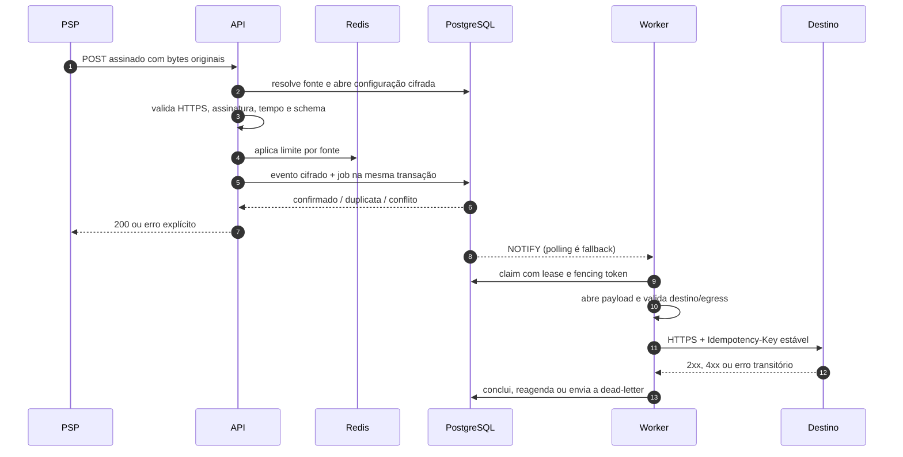
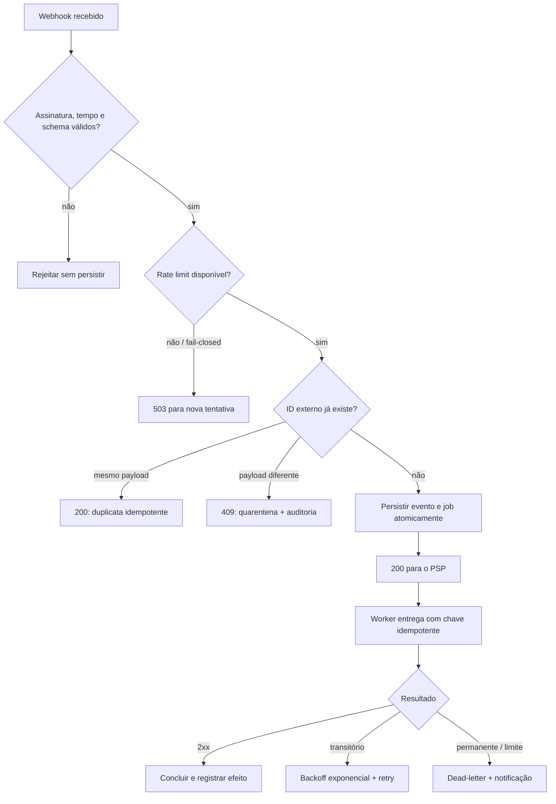
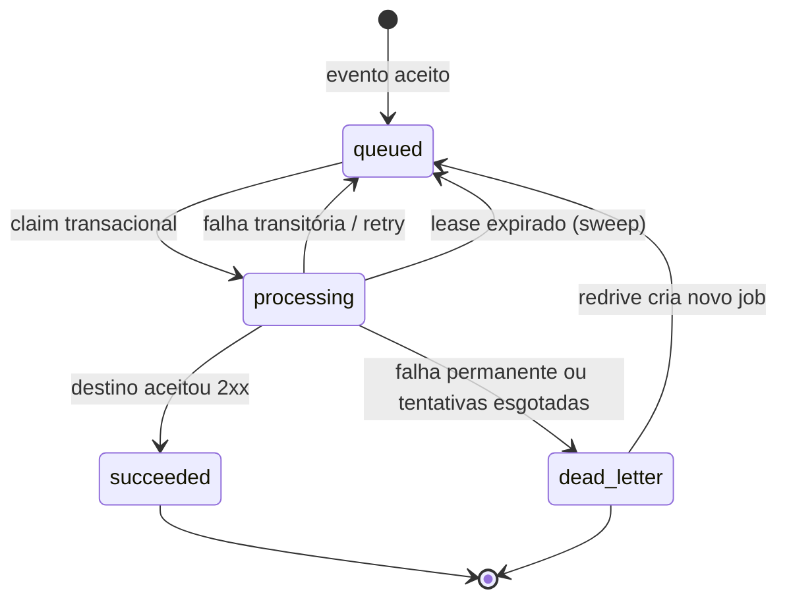
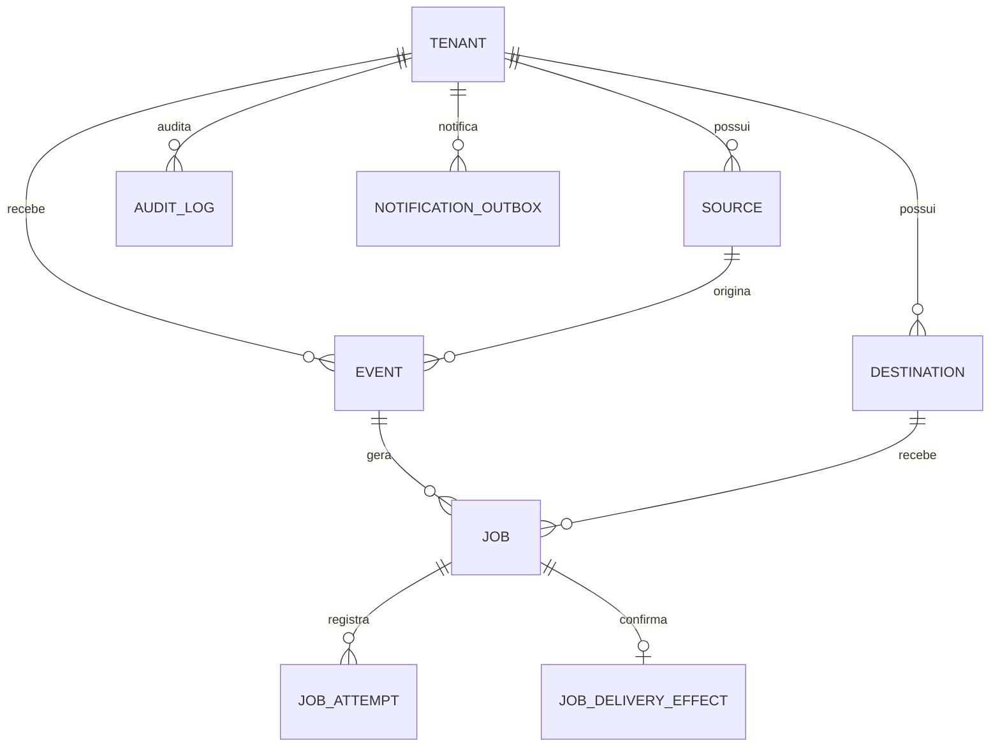
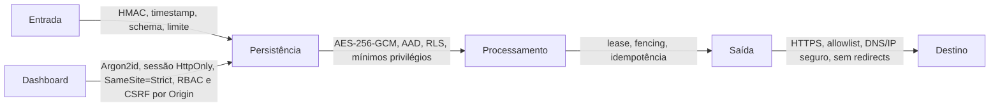

# Desenho de sistema

## Produto e problema resolvido

O Sluice é uma plataforma **self-hosted de ingestão e orquestração de
webhooks** para empresas que precisam transformar notificações de provedores
em ações confiáveis, auditáveis e isoladas por cliente (tenant). Ele atende
especialmente fluxos financeiros brasileiros: um PSP emite um evento, o Sluice
o valida e persiste, e um worker entrega a consequência ao sistema de destino.

O produto separa deliberadamente a confirmação ao provedor do efeito externo.
Assim, uma instabilidade no ERP, CRM ou serviço do cliente não faz o webhook
ser perdido nem mantém uma conexão do PSP aberta.

## Princípios de produto

1. **Durabilidade antes de velocidade:** o evento é confirmado somente após a
   gravação transacional no PostgreSQL.
2. **Isolamento por padrão:** identidade do tenant vem da fonte configurada,
   nunca do corpo recebido; o banco aplica RLS como defesa independente.
3. **Privacidade proporcional:** payloads são cifrados, expiram e não entram
   em logs; o mínimo necessário para deduplicação e auditoria permanece.
4. **Operação compreensível:** a interface mostra estado, tentativa, causa e
   próxima ação, sem exigir que a pessoa operadora inspecione o banco.
5. **Falhas esperadas:** retries, leases, reconciliação e dead-letter são
   partes do fluxo normal, não rotinas de exceção.

## Contexto e fronteiras

Fora da fronteira de confiança ficam PSPs, navegadores de operadores e
destinos HTTP. PostgreSQL, Redis e as redes de serviço não são publicados na
internet. A borda HTTPS, WAF, firewall de egress e gestão de identidade são
responsabilidades da implantação.

## Componentes e responsabilidades

| Camada | Componente | Responsabilidade | Não faz |
|---|---|---|---|
| Borda | API Fastify/TypeScript | autentica, limita, valida e persiste | entregar ao destino no request do PSP |
| Estado | PostgreSQL 17 | eventos, fila, RLS, auditoria, retenção | depender do Redis para correção |
| Efêmero | Redis 7 | rate limit e wake-up opcional | armazenar jobs ou payloads |
| Execução | Worker C#/.NET 8 | claim, entrega, retry e reconciliação | confiar em URL arbitrária ou redirect |
| Operação | Dashboard Next.js | visibilidade, configuração e redrive autorizado | contornar RLS ou expor segredos |
| Agenda | pg_cron | tarefas duráveis e periódicas | eleger líder entre réplicas |

## Fluxo principal: do webhook ao efeito

### Decisão de processamento

## Estados e recuperação de jobs

O redrive não reabre um job terminal: cria outro job ligado ao anterior. Isso
preserva o histórico e evita apagar evidências da falha. A entrega é
**at-least-once**; a chave `Idempotency-Key` torna o efeito effectively-once
quando o destino também a respeita.

## Modelo de dados e isolamento

Todas as entidades de domínio carregam `tenant_id`. Chaves estrangeiras
compostas e `FORCE ROW LEVEL SECURITY` impedem referências cruzadas e leituras
indevidas mesmo se uma consulta de aplicação estiver incorreta.

## Jornada de operação e UX

O dashboard é projetado para três decisões rápidas: **o que está acontecendo,
o que exige ação e qual é a próxima ação segura**.

| Persona | Necessidade | Resposta da interface |
|---|---|---|
| Owner | governança e tenants | troca explícita de contexto, RBAC e auditoria |
| Admin | configurar fontes/destinos | formulários com validação, segredos mascarados e confirmação |
| Operator | recuperar falhas | fila priorizada, causa, histórico e redrive com trilha de auditoria |
| Viewer | acompanhar saúde | métricas, filtros e detalhes somente leitura |

Padrões obrigatórios da interface:

- contraste e foco visível, navegação por teclado e rótulos acessíveis;
- estados de carregamento, vazio, sucesso e erro explicam a próxima ação;
- ações destrutivas ou de impacto operacional pedem confirmação contextual;
- tenant ativo permanece evidente em toda a navegação;
- dados sensíveis não aparecem em listagens, toasts ou mensagens de erro;
- layout responsivo preserva tarefas essenciais em telas menores.

## Segurança por fluxo

Para uma avaliação detalhada de ameaças, responsabilidades operacionais e
rotação de segredos, consulte o [modelo de segurança](security.md). A
arquitetura reduz riscos relevantes, mas não substitui WAF, MFA/OIDC, gestão
de segredos, firewall de egress, backup testado, monitoramento e pentest antes
da produção.

## Critérios de aceite para produção

1. Variáveis de exemplo e credenciais de demonstração foram substituídas.
2. HTTPS e TLS interno estão ativos; PostgreSQL e Redis não têm porta pública.
3. MFA/OIDC ou controle de acesso equivalente protege operadores privilegiados.
4. Egress do worker é restrito à allowlist também na rede.
5. Backup com PITR e restauração foram testados.
6. Alertas acompanham idade do job, backlog, retries, dead-letters e falhas de
   autenticação.
7. Testes automatizados, análise de dependências, scan de imagem e pentest
   foram executados para a versão implantada.

## Leituras complementares

- [Arquitetura e decisões](architecture.md)
- [Banco, roles e contratos](database.md)
- [API e contratos de entrega](api.md)
- [Operação e recuperação](operations.md)
- [Segurança e threat model](security.md)
- [Retenção e LGPD](lgpd-retention.md)
